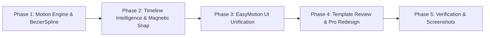

# Design Specification: Enterprise Motion Resolve Suite Overhaul

**Title**: Enterprise Motion Resolve Suite Overhaul  
**Date**: 2026-10-29  
**Status**: Approved (Brainstorming Complete)  
**Authors**: Antigravity & Video Design Team  

---

## 1. Objective & Vision

Transform **Motion Resolve** from a capable prototype into an enterprise-grade, broadcast-ready DaVinci Resolve typography and animated caption plugin suite. The overhaul addresses five core pillars:
1. **Motion Engine Overhaul**: Replaces crude math expressions with native `BezierSpline` / `LUTLookup` easing curves matching `/Volumes/Zabid/Zabid/Davinci Plugin` reference packages (`NeoEditFX`, `Animated Text Pack 2.0`, `Neo Anim.setting`, `SaaS Text Animation`).
2. **Timeline Intelligence & Footage Protection**: Automatic collision avoidance (never overwriting video footage on Track 1), dedicated track re-use, safe-zone clamping, and Footage Magnetic Snapping.
3. **UI Color, Tone & Theme Unification**: 100% faithful replication of the EasyMotion Obsidian Dark (`#0d0b14`) + Glowing Neon Orange (`#ff5500`) design system across all tabs and widgets.
4. **Enterprise Template Review & Category Gallery**: Category filter pills with live item counts, real-time search, animated 60fps scrubbable preview canvas, and pro card metadata badges.
5. **Pro Template & Preset Redesign**: Elimination of amateur aesthetics; elevation to Fortune 500 SaaS (Linear/Stripe), high-retention viral agency (Hormozi/Vox), and cinematic documentary typography.

---

## 2. Architecture & Subsystems

```mermaid
flowchart TD
    subgraph UI_Layer ["Unified Enterprise UI (Obsidian & Neon Orange)"]
        Nav[Segmented Pill Navbar · Workspace | Templates | Titles | Auto]
        W_Tab[WorkspaceTab · Phone Canvas 9:16 + Motion D-Pads]
        T_Tab[TemplatesTab · Category Pills + 60fps Scrub Canvas]
        P_Tab[TitlesTab · Studio Presets Gallery + Dual-Font Hero]
        A_Tab[AutoTab · Batch Cue Editor + Magnetic Sync]
        Drawer[ConvertCaptionsDrawer · Glowing Orange Border]
    end

    subgraph Core_Engines ["Core Engine Subsystems"]
        TI[TimelineIntelligence · Collision Avoidance & Magnetic Snap]
        RB[ResolveBridge · Fusion Comp & Modify Snapshots]
        AE[AnimationEngine · BezierSpline & Damped Spring Easing]
        FC[FusionCompiler · Mathematical Spacing & Spline Generators]
        TPB[TextPlusBuilder · Dual-Font Script Engine & Safe Coercion]
        SM[StyleManager · 33 Curated 60-30-10 Presets]
        TR[TemplateRegistry · 54 Categorized Declarative Templates]
    end

    Nav --> W_Tab & T_Tab & P_Tab & A_Tab
    W_Tab --> TI & RB & AE & TPB
    T_Tab --> TR & FC & RB
    P_Tab --> SM & TPB & RB
    A_Tab --> TI & TPB & AE
    Drawer --> TI & SM & TPB
```

---

## 3. Subsystem Specifications

### 3.1 Motion Engine & Curve Easing (`core/animation_engine.py` & `core/templates/motion_tokens.py`)

#### Problem in Prior Version
Transitions used basic text expressions (`(1 - t / dur)^2` or crude `math.exp * math.cos`), causing abrupt acceleration, unnatural bounce oscillations, and visual clipping on exit.

#### Enterprise Solution
- **Native Bezier Spline Handles**: Replicate the exact mathematical curves from `NeoEditFX`:
  - **Cubic Expo-Out (Slide Entrances)**: Cubic Bezier handle `(0.16, 1.0, 0.30, 1.0)`. Fast initial entry decelerating into a buttery resting state.
  - **Damped Harmonic Spring (Bounce Entrances)**: 4-stage natural settling:
    $$\text{Value}(t) = 1.0 + 0.08 \cdot e^{-6t} \cdot \cos(14t)$$
    Keyframe overshoot values: `0.0 -> 1.075 -> 0.965 -> 1.002 -> 1.0`.
  - **True Off-Screen Bounds**:
    - Slide Up starts at $Y = -0.65 \times \text{distance}$ below resting point.
    - Slide Down starts at $Y = +0.65 \times \text{distance}$ above resting point.
    - Slide Left/Right starts at $X = \pm 0.75 \times \text{distance}$.
    - First and last frames guaranteed zero opacity (`Alpha = 0.0`).
  - **Exit Transitions**: Smooth cubic ease-in acceleration (`t^3`) off-screen with simultaneous linear fade over the final 8 frames, eliminating sudden pop-offs.

---

### 3.2 Timeline Intelligence & Footage Magnetic Snapping (`core/timeline_intelligence.py` & `core/resolve_api.py`)

#### Problem in Prior Version
Calling `InsertFusionTitleIntoTimeline` without track collision detection risked splitting or overwriting existing video footage on Track 1.

#### Enterprise Solution
1. **Intelligent Track Selection (`find_best_title_track`)**:
   - Given start and end frames `[start_frame, end_frame]`:
   - Inspects all video tracks from Track 1 up to `num_tracks`.
   - If Track 1 contains any video clips in `[start_frame, end_frame]`, it is protected as A-roll.
   - Searches upward for the lowest existing video track with zero clip overlap in `[start_frame, end_frame]`.
   - Reuses tracks named `"Captions"` or `"Motion Titles"` if available.
   - If all tracks are occupied, calls `timeline.AddTrack("video")` and targets the newly created top track.
2. **Footage Magnetic Snapping (`detect_magnetic_snap_bounds`)**:
   - Detects the video clip directly beneath the playhead on the lowest video track.
   - Snaps the inserted title duration exactly to `[clip.GetStart(), clip.GetEnd()]`.
   - Threshold snapping: if an In/Out mark is within 12 frames of an edit cut, magnetically snaps to the cut.
3. **9:16 Safe Zone Auto-Clamping**:
   - If timeline aspect ratio is 9:16 (1080x1920):
     - Bottom margin clamped to $\ge 24\%$ (clears TikTok/Reels captions/music tag).
     - Top margin clamped to $\le 88\%$ (clears status bar/search).
     - Right margin clamped to $\le 86\%$ (clears engagement icons).

---

### 3.3 UI Color, Tone & Theme Unification (`ui_qt/styles.py` & all tabs)

#### Reference Palette (EasyMotion Obsidian & Neon Orange)
```css
/* Core Palette Tokens */
--color-bg-base:        #0d0b14;
--color-surface-card:   #13101d;
--color-surface-elev:   #181426;
--color-border-subtle:  #26203a;
--color-border-card:    #1e1930;
--color-accent-orange:  #ff5500;
--color-accent-hover:   #ff6a1a;
--color-accent-active:  #e04a00;
--color-text-primary:   #f3f1fa;
--color-text-secondary: #9d93b8;
--color-text-muted:     #635b7b;
```

#### Widget Styling
- **Segmented Navbar**: Dark capsule container (`#0d0b14`), active pill solid orange (`#ff5500`), inactive pills `#171325` with `#282140` border.
- **Phone Canvas**: 16px curved corners, dark obsidian backdrop (`#000000`), neon pink center crosshairs, orange corner handles, floating bottom zoom capsule `[- 100% +]`.
- **Motion D-Pads**: Left and right directional pads with center dot, active mode pills (`Slide | Bounce`), central effect toggles (`Shake`, `Jitter`, `Scribble`, `M. Blur`) glowing orange when active, full-width `[ AUTO ]` pill with orange outline.
- **Convert Drawer**: Glowing 1.5px orange border (`#ff5500`), background `#171225`, orange action button.

---

### 3.4 Enterprise Template Review & Category Gallery (`ui_qt/tabs/templates_tab.py`)

#### Category Filter Pills
- Horizontal pill strip with live counts:
  - `All (54)`
  - `Viral Agency (6)`
  - `SaaS & Tech (8)`
  - `Cinematic Documentary (8)`
  - `Minimal Luxury (8)`
  - `Modern Creator (8)`
  - `Broadcast & News (8)`
  - `Bold Kinetic (8)`
- Real-time search filter with `✕` clear action.

#### Interactive 60fps Scrub Canvas
- Integrated scrub bar beneath preview canvas with Play/Pause button `[ ▶ / ❚❚ ]` and frame counter.
- Dragging the scrub bar evaluates keyframes dynamically via `evaluate_easing` at current playback phase ($0.0 \to 1.0$), showing exact entrance, hold, and exit animations in real time.
- Pro card metadata badges: Aspect Ratio (`9:16`, `16:9`), Easing Token (`Expo Slide`, `Damped Spring`), and Font Pair.
- Quick Apply hover button directly on each grid card.

---

### 3.5 Pro Template & Preset Redesign

1. **SaaS & Tech Suite**:
   - Frosted glass containers (`alpha = 0.88`, subtle gradient border).
   - Monospace statistics + clean sans (JetBrains Mono + Syne / Inter).
   - Metrics, product badges, and notification capsules.
2. **Viral Agency Suite**:
   - Bold headlines with script hero word accents (Montserrat Black + Pinyon Script).
   - 360° ambient diffusion glow shadows (`Offset = [0, 0]`, `Softness = 0.045`, `Alpha = 0.50`).
3. **Cinematic Documentary Suite**:
   - Letter-spaced serif typography (Cinzel / DM Serif / Playfair).
   - Underline accent rules and golden-ratio baseline alignment.
4. **Minimal Luxury Suite**:
   - Editorial high-fashion aesthetics (Bodoni / Didot).
   - Champagne, warm gold, and platinum color tokens.

---

## 4. Implementation Phasing



- **Phase 1**: Rebuild `core/animation_engine.py` motion curves with reference-grade BezierSpline & damped harmonic spring physics.
- **Phase 2**: Implement `core/timeline_intelligence.py` for track collision avoidance, footage protection, and magnetic cut snapping.
- **Phase 3**: Unify complete UI across all tabs and widgets with EasyMotion Obsidian `#0d0b14` + Neon Orange `#ff5500`.
- **Phase 4**: Upgrade `ui_qt/tabs/templates_tab.py` with category filter pills, live 60fps scrub canvas, and pro template cards.
- **Phase 5**: Full test suite execution (70+ tests passing) and UI visual screenshot capture across all 4 tabs.

---

## 5. Verification & Testing Strategy

1. **Motion Curve Tests**: Verify `evaluate_easing` for `expoOut`, `softSpring`, `quartInOut` match reference control points. Verify entrance/exit boundary values ($0.0$ at endpoints).
2. **Timeline Intelligence Tests**: Test collision detection with simulated multi-track timelines. Verify A-roll video protection on Track 1 and automatic track addition.
3. **UI Theme Consistency Tests**: Test all widgets against color tokens. Verify active/inactive stylesheet states.
4. **Automated Unit Tests**: Discover and execute all tests via `python3 -m unittest discover tests`.
